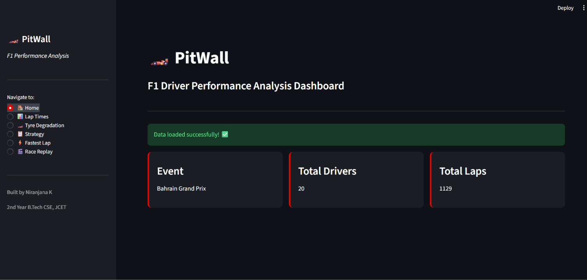
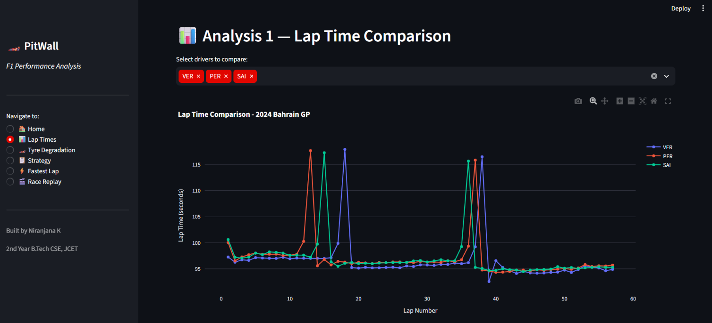
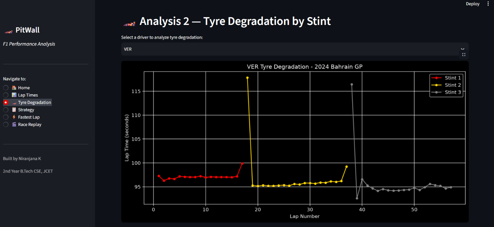
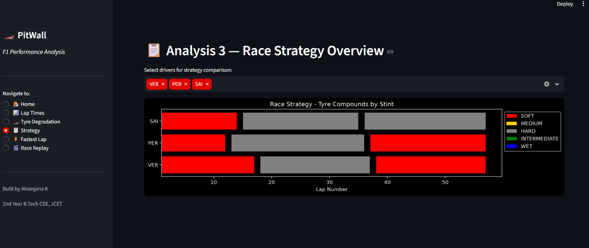
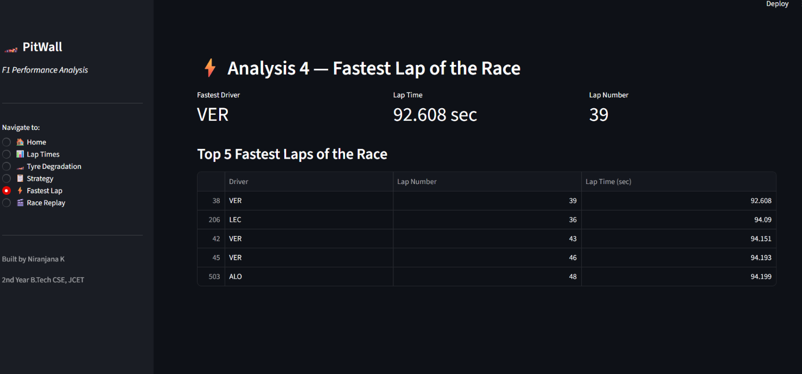
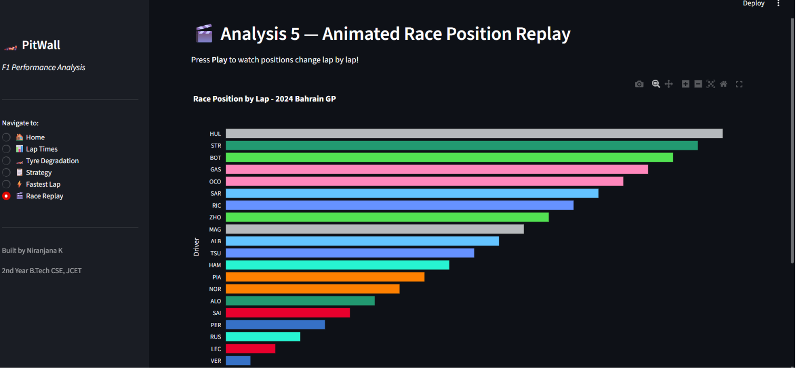

# PitWall: F1 Driver Performance Analysis

A web-based dashboard that analyses real Formula 1 race data from the 2024 Bahrain Grand Prix. Built with Python and Streamlit, developed in VS Code, and version controlled with Git and GitHub.

**Author:** Niranjana K, B.Tech CSE, Jawaharlal College of Engineering and Technology

## Features
- **Lap Times:** compare any drivers lap by lap with interactive charts (hover and zoom)
- **Tyre Degradation:** see how lap times change across each stint for any driver
- **Race Strategy:** view each driver's tyre compounds and pit stop strategy
- **Fastest Lap:** find the fastest lap of the race and the top 5 laps
- **Race Replay:** animated lap-by-lap position chart with team colours

## Screenshots

### Home


### Lap Time Comparison


### Tyre Degradation


### Race Strategy


### Fastest Lap


### Race Replay


## Tech Stack
- Python
- FastF1 (race data)
- Pandas (data processing)
- Matplotlib and Plotly (visualisation)
- Streamlit (web app)
- Git and GitHub (version control)
- VS Code (IDE)

## How to Run
1. Clone the repository:
```
   git clone https://github.com/niranjanak203-hash/PitWall.git
   cd PitWall
```
2. Install the libraries:
```
   python -m pip install streamlit fastf1 pandas matplotlib plotly
```
3. Start the app:
```
   python -m streamlit run app.py
```
The first run needs an internet connection to download the race data. After that, it is cached locally.

## What I Learned
- Loading and cleaning real telemetry data with FastF1 and Pandas
- Reading race strategy from lap time, stint and tyre data
- Building an interactive dashboard in Streamlit
- Using Git: init, add, commit, push, pull and resolving a merge